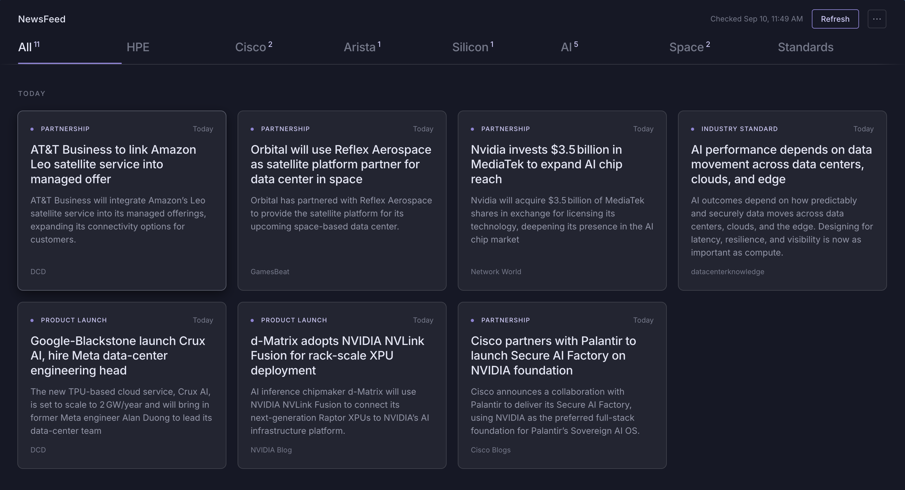

# NewsFeed

A daily brief on data center networking. Reads ~30 sources, picks the few
stories worth knowing, and writes a summary when you open one.

**[Live site](https://news-agg-v2.vercel.app/)**



Seven beats — HPE/Juniper, Cisco, Arista, merchant silicon, AI infrastructure,
orbital data centers, and networking standards (RoCE, Ultra Ethernet, IEEE,
OCP). Three or four stories each, sorted by publish date.

## How it works

RSS from trade press, vendor newsrooms and engineering blogs, plus a Google
News query per beat. Items matching that beat's keywords go to an LLM, which
picks the three or four most significant and tags each one. Summaries are
written on demand, the first time you open a story.

Dismissing a story records the source, tag and beat as a negative signal.
Submitting a URL the pipeline missed marks that source trusted, so future
items from it rank higher.

## Design notes

**Refresh runs one beat per request.** Vercel's Hobby tier kills a function at
60 seconds and Groq's free tier caps tokens per minute — seven beats in one
call fits neither. The client walks the beats with a cursor and shows progress.

**Dedupe happens before the LLM, not after.** Candidates are checked against
stored URLs first, so re-runs cost nothing in tokens. The stories table doubles
as the ledger, which is also why read stories are never deleted.

**Summaries are lazy.** Writing all 28 upfront would blow the daily token
budget on stories you'd never open. One call per story, on first click.

**Relevance is judged by meaning, not keywords.** Every new candidate is
embedded (Gemini) and compared with its beat's written profile and the stories
you saved or submitted, and against a shared list of off-topic descriptions
(campus Wi-Fi, security, events…) and the stories you dismissed. It stays only
if it sits closer to the first group. Keywords match whole words now and only
give a small boost — or do the filtering on their own if `GEMINI_API_KEY` is
missing or the embedding call fails. `/api/refresh?mode=preview&cursor=N`
returns one beat's scores without calling the LLM or storing anything; set
`RELEVANCE_MARGIN` to tighten or loosen the cut (default 0.035).

Each beat's profile is a list of short single-topic lines, and a story stays on
a beat only if that beat is its closest match among all seven — so a generic
data center build lands on the AI beat, not on HPE. Those fixed lines are
embedded once into `api/_lib/profile-vectors.json`; after editing them, rerun
`GEMINI_API_KEY=… node scripts/embed-profiles.mjs`. Gemini's free tier allows
100 embeddings a minute, so a beat embeds at most ~50 texts and the page starts
beats 30 seconds apart: a full refresh takes about three and a half minutes.

## Stack

Vanilla JS frontend, no build step. Vercel serverless functions. Supabase for
storage. Groq for inference (`openai/gpt-oss-20b`).

Runs free on all three: Groq's free tier covers ~30 calls a day, Supabase's
500 MB holds years of stories at a couple of KB each, and the whole thing fits
in Hobby's function limits.

<details>
<summary><b>Running it yourself</b></summary>

**1.** Create a Supabase project. In `migration.sql`, change `you@example.com`
(section 7) to your own email, then run the file in the SQL Editor.

**2.** Get a free API key from [console.groq.com](https://console.groq.com).

**3.** Import the repo into Vercel and set:

| Variable | Where it comes from |
| --- | --- |
| `SUPABASE_URL` | Supabase → Project Settings → API |
| `SUPABASE_SERVICE_ROLE_KEY` | same page, the `service_role` key |
| `LLM_API_KEY` | console.groq.com |
| `LLM_MODEL` | `openai/gpt-oss-20b` |
| `REFRESH_SECRET` | any random string (for the cron and preview/backfill URLs) |
| `GEMINI_API_KEY` | aistudio.google.com → Get API key (embeddings for relevance) |

**4.** Fill in `SUPABASE_URL` and `SUPABASE_ANON_KEY` at the top of the script
in `public/index.html`. The anon key is public by design; sign-in and
row-level security decide what anyone can read or change.

**5.** In Supabase → Authentication → URL Configuration, set the Site URL to
your Vercel URL and add it (plus `http://127.0.0.1:*` for local testing) to the
redirect URLs.

**6.** Supabase's built-in email only delivers sign-in links to members of your
Supabase team, a few an hour. To let anyone else sign in, connect your own
email sender under Authentication → Emails → SMTP Settings (Resend's free
tier works).

Deploy, then use "Email me a sign-in link" on the sign-in screen. Your first
sign-in inherits the read and saved state stored so far.

**Passwords** — the first time someone arrives from an email link, the page
asks them to create a password (or "Later", which waits a week). After that
they sign in with email and password, so no email is sent and Supabase's
email rate limit doesn't get in the way. Forgot it? The same email link signs
them in, and Account → Change password sets a new one. The page refreshes the shared feed on open if the
last full run, by anyone, was over 20 hours ago.

**Inviting people** — only emails on the invite list can sign in. As the admin,
open the account button (your initial, top right) → People: type an email and
press Invite. Tick "Email them a sign-in link" to send one (needs the email
sender from step 6); otherwise just tell them the site URL. The list shows who
has signed in, and Remove takes away access and deletes their read and saved
lists. (The same list lives in the `allowed_emails` table if you prefer SQL.)

Everyone shares one feed but has their own read, saved and hidden stories.
Only the admin (`is_admin`) trains it: the admin's saves, added stories and
"Not relevant" clicks shape what the refresh finds. For everyone else the
button says "Hide" and only hides the story for them.

**Backfill** — a normal refresh looks back 5 days. To reach further:

```
/api/refresh?mode=backfill&cursor=6&secret=YOUR_SECRET
```

21-day window, up to 8 stories per beat. `cursor` is the beat index, 0–6.

**Adding a source** — feeds and keywords live in `api/_lib/sources.js`, one
array of each per beat.

```
api/
  refresh.js      fetch, filter, select
  summarize.js    on-demand summaries
  submit.js       manual story submission
  feedback.js     hides a story; the admin's also train
  invites.js      the admin's People panel: invite, list, remove
  _lib/
    sources.js    feeds and keywords per beat
    util.js       Groq client, RSS parsing, helpers
public/
  index.html      the whole frontend
migration.sql     schema
vercel.json       cron + routing
```

</details>
